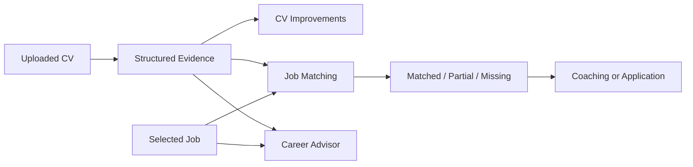
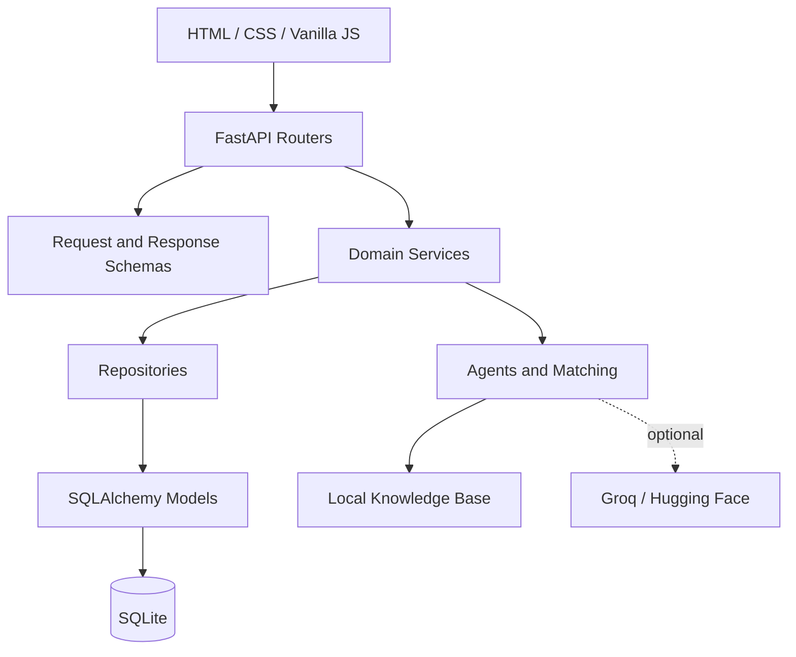
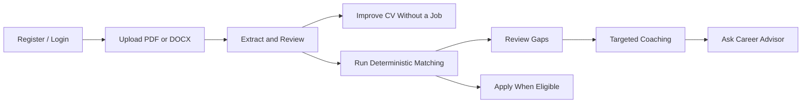
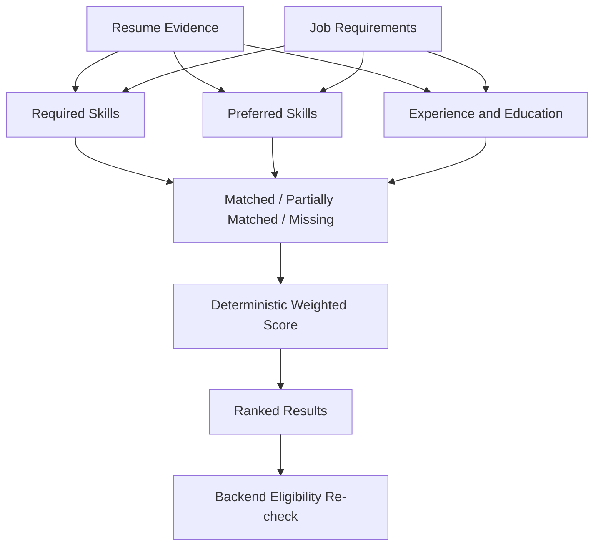
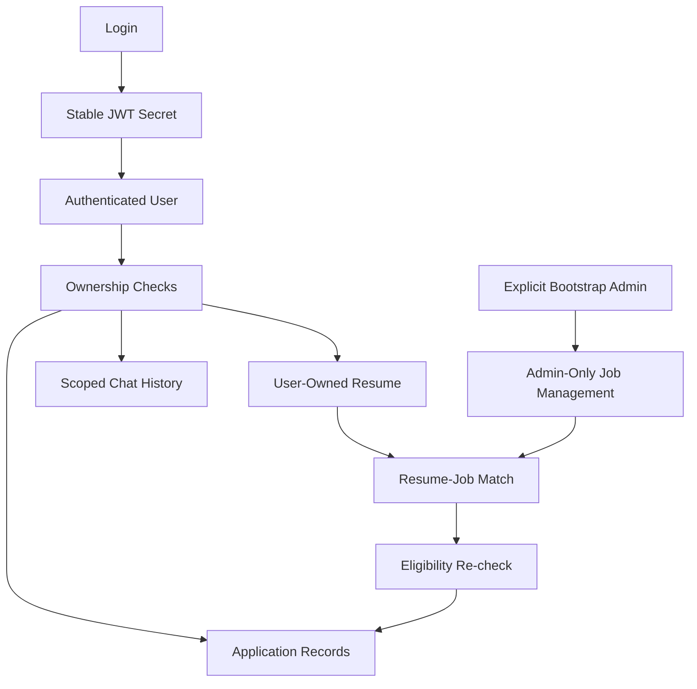

# AI Resume Analyzer

> **A practical, evidence-grounded tool for turning a CV into useful career decisions.**
>
> Built, tested, and hardened by the project owner and their team.

AI Resume Analyzer is a local-first web application that helps a candidate understand a resume, improve it, compare it with job requirements, and decide what to do next. We built it around a simple idea: a recommendation is more useful when the user can see where it came from and which context it belongs to.

The application accepts PDF and DOCX resumes, extracts structured profile data, produces grounded improvement suggestions, ranks job matches, records eligible applications, and provides a Career Advisor with explicit resume/job context.

## At a glance

| Area | Implementation |
|---|---|
| Backend | Python, FastAPI, SQLAlchemy |
| Database | SQLite with scoped repositories and foreign keys |
| Frontend | Static HTML, CSS, and Vanilla JavaScript |
| Resume input | PDF and DOCX, maximum 5 MB, signature validation, bounded DOCX archive expansion |
| Matching | Deterministic required/preferred skill and requirement comparison |
| AI integrations | Optional Groq generation and Hugging Face semantic retrieval |
| Fallback | Local deterministic analysis and honest provider-unavailable responses |
| Verification | Functional/regression tests, focused upload guards, live HTTP flows, authorization audits, and database integrity checks |

## The main idea

A generic chatbot can write a convincing answer without knowing whether the answer is supported by the user’s resume. This project takes a different approach. The server keeps the selected user, resume, and job explicit, then chooses the correct operation and evidence boundary before producing a response.



The result is not only a score. It is a chain from document, to evidence, to explanation, to an action the candidate can understand.

## Architecture

The frontend is deliberately thin. It handles forms, page state, and API calls, while validation, authorization, business rules, and evidence boundaries stay on the server.



### What each layer is responsible for

| Layer | Responsibility |
|---|---|
| Frontend | Displays data, sends requests, and keeps visible state in sync. It is not the security boundary. |
| Routers | Expose the HTTP API, attach authentication dependencies, validate requests, and return safe responses. |
| Schemas | Define the shape of API input and output and reject invalid data early. |
| Services | Coordinate file processing, resume analysis, jobs, matching, applications, and chat. |
| Agents | Route questions, analyze resumes, compare requirements, and generate controlled advisor responses. |
| Repositories | Keep database queries organized by domain instead of spreading SQLAlchemy logic through the app. |
| Models | Define users, resumes, jobs, chats, applications, recommendations, and blacklisted tokens. |
| RAG | Supplies general career guidance. It is never used as proof of a candidate’s personal experience. |

## User workflow



The workflow does not force the candidate to choose a job before improving a resume. General coaching is available on its own. Job-specific coaching and comparison require an explicitly selected resume and job.

## Resume processing

The upload service follows a defensive pipeline:

1. It accepts only PDF and DOCX files up to 5 MB.
2. It checks the extension and the content signature before parsing.
3. It verifies the structure and integrity of DOCX archives.
4. It stores the file under a generated UUID filename rather than trusting the original name.
5. It extracts structured fields such as contact information, skills, education, experience, projects, certifications, languages, summary, strengths, and weaknesses.
6. It validates optional model output before accepting it.
7. It falls back to deterministic local analysis when a provider is missing, times out, or returns malformed JSON.

This means a renamed or malformed file is rejected before it reaches the parser, and an external provider failure does not make the core resume workflow unusable.

## Deterministic job matching

Matching is intentionally explicit. The selected resume is compared with a selected job’s required skills, preferred skills, experience, and education.



Required and preferred skills are reported separately. A preferred skill cannot silently compensate for a missing required requirement. The application layer also checks resume ownership, job status, deadlines, duplicate applications, and application caps before recording a submission.

## Career Advisor and context boundaries

The Career Advisor uses the question’s intent to choose a route. A selected job can provide context, but it cannot force every question into the job route.

| Question | Allowed context |
|---|---|
| Profile or resume | The authenticated user and selected resume |
| Job requirements | The selected job |
| Resume/job comparison | The selected resume-job pair |
| General career question | The local knowledge base and retrieved guidance |
| Unsupported request | A clear out-of-scope response |

The routing rule also recognizes natural candidate-skill questions such as:

```text
What skills does the candidate have that match the selected job?
→ Comparison Agent

What skills is the candidate missing for the selected job?
→ Comparison Agent
```

The comparison response separates matched required skills, matched preferred skills, missing required skills, and missing preferred skills. It is calculated from the current resume and job records; it is not a fixed answer stored in the code.

### Evidence boundary

The local knowledge base can explain a career concept, but it cannot prove that a candidate has a skill. Resume content, job descriptions, retrieved text, and previous chat messages are treated as data, not as instructions. Previous assistant messages are conversation context only and never become authoritative resume evidence.

## Security and reliability

Security is enforced by the backend rather than by hiding controls in the browser.



The repaired implementation includes:

- A required, stable `SECRET_KEY`; the application fails fast instead of generating an unknown signing key on restart.
- Hashed passwords and token blacklisting after logout.
- Explicit administrator bootstrap variables with no bundled password.
- Server-side ownership checks for resumes, jobs, chats, recommendations, and applications.
- Admin-only job creation, update, and deletion.
- Request IDs and structured logs that do not record credentials or raw documents.
- Safe normalization of provider and parser failures.
- Lowercased registration emails, bounded non-blank chat messages, and resilient parsing of legacy JSON columns.
- SQLite-only engine options are applied conditionally so a configured non-SQLite SQLAlchemy backend is not rejected by SQLite-specific arguments.
- Embedding-cache validation using model, version, content fingerprint, and vector shape rather than entry count alone.
- No silent password reset for an existing administrator during restart.

## Administrator setup

The administrator is created from environment variables, not from a credential hidden in the repository:

```bash
cp .env.example .env
```

Set these values before startup:

| Variable | Meaning |
|---|---|
| `SECRET_KEY` | Stable JWT signing key, at least 32 characters |
| `ADMIN_USERNAME` | Bootstrap administrator username |
| `ADMIN_EMAIL` | Bootstrap administrator email |
| `ADMIN_PASSWORD` | Bootstrap administrator password |

A normal registration always creates a normal user. The configured administrator can manage jobs, including deadlines and application caps. Closed jobs remain visible but reject new applications.

## Run locally

### One-command startup

#### Linux or macOS

```bash
chmod +x run.sh
./run.sh
```

#### Windows

```bat
run.bat
```

On the first run, the launcher creates `.venv`, installs `requirements.txt`, creates a local `.env`, generates stable local credentials, and starts the server. Later runs reuse the same `.env` and database. Never commit `.env`.

Open the application at [http://127.0.0.1:8000/](http://127.0.0.1:8000/). The interactive API documentation is available at [http://127.0.0.1:8000/docs](http://127.0.0.1:8000/docs).

### Manual startup

```bash
python -m venv .venv
source .venv/bin/activate
pip install -r requirements.txt
cp .env.example .env
# Edit .env with unique local values.
uvicorn main:app --reload
```

## Configuration reference

| Variable | Required | Purpose |
|---|---:|---|
| `SECRET_KEY` | Yes | Stable JWT signing key |
| `ADMIN_USERNAME` | Yes | Bootstrap admin username |
| `ADMIN_EMAIL` | Yes | Bootstrap admin email |
| `ADMIN_PASSWORD` | Yes | Bootstrap admin password |
| `DATABASE_URL` | No | SQLAlchemy database URL; defaults to local SQLite |
| `ACCESS_TOKEN_EXPIRE_MINUTES` | No | JWT lifetime |
| `GROQ_API_KEY` | No | Optional text-generation provider |
| `GROQ_MODEL` | No | Optional Groq model name |
| `HF_TOKEN` | No | Optional Hugging Face token |
| `HF_MODEL` | No | Optional embedding/model configuration |
| `HF_RAG_MODEL` | No | Optional semantic RAG model |
| `CORS_ORIGINS` | No | Allowed frontend origins |

## Main API surface

| Method | Endpoint | Purpose | Access |
|---|---|---|---|
| `POST` | `/api/auth/register` | Register a normal user | Public |
| `POST` | `/api/auth/login` | Login by email or username | Public |
| `POST` | `/api/auth/logout` | Blacklist the current token | Authenticated |
| `POST` | `/api/resumes/upload` | Upload and analyze a resume | Authenticated |
| `POST` | `/api/resumes/{resume_id}/analyze` | Re-run resume analysis | Owner |
| `POST` | `/api/resumes/{resume_id}/improvements` | Generate scoped improvements | Owner |
| `POST` | `/api/match/{resume_id}` | Return deterministic matches | Owner |
| `GET` | `/api/recommendations` | Read saved recommendations | Authenticated |
| `GET` | `/api/jobs` | Browse jobs | Authenticated |
| `POST/PUT/DELETE` | `/api/jobs...` | Manage jobs | Administrator |
| `POST` | `/api/jobs/{job_id}/apply?resume_id={id}` | Submit an eligible application | Authenticated |
| `POST` | `/api/chat` | Route advisor and comparison questions | Authenticated |
| `GET/DELETE` | `/api/chat/history` | Read or clear scoped history | Authenticated |
| `GET` | `/api/health` | Check service health | Public |

## Repository map

```text
.
├── app/
│   ├── agents/          # Intent routing, resume analysis, matching, and advisor
│   ├── core/            # Environment configuration and security utilities
│   ├── database/        # SQLAlchemy setup and schema migration helpers
│   ├── dependencies/    # FastAPI dependency hooks
│   ├── exceptions/      # Domain exceptions and safe error handlers
│   ├── middleware/      # Request IDs and structured request logging
│   ├── models/          # SQLAlchemy tables and relationships
│   ├── rag/             # Knowledge base, retrieval, and cache validation
│   ├── repositories/    # Database access by domain
│   ├── routers/         # HTTP endpoints
│   ├── schemas/         # Input and output validation models
│   └── services/        # Domain orchestration and provider adapters
├── frontend/
│   ├── css/style.css    # Shared interface styling
│   ├── js/              # API, auth, dashboard, resume, jobs, matching, advisor
│   └── *.html           # Static application pages
├── tests/               # Functional, regression, live-flow, and audit scripts
├── presentation/        # Project presentation and post-run screenshot showcase
├── uploads/.gitkeep     # Empty runtime upload directory for a clean checkout
├── .env.example         # Safe configuration template
├── .gitignore            # Runtime and secret exclusions
├── main.py               # Root Uvicorn entry point
├── requirements.txt      # Runtime and test dependencies
├── requirements-dev.txt  # Ruff and development validation dependencies
├── pytest.ini            # Pytest configuration
├── run.sh                # Linux/macOS launcher
├── run.bat               # Windows launcher
└── README.md             # Project documentation
```

## Screenshots and presentation material

The repository includes the project presentation and a screenshot showcase under `presentation/`:

- [`presentation/Project Presentation.pptx`](presentation/Project%20Presentation.pptx) — the full project presentation.
- [`presentation/screenshots.pdf`](presentation/screenshots.pdf) — screenshots captured from the running application using safe demo data.

These artifacts show the authentication flow, dashboard, resume analysis, job board, deterministic matching, and Career Advisor screens. They are included as project documentation and do not contain a real private resume.

## Testing and verification

Run the default checks with:

```bash
pytest -q
for f in frontend/js/*.js; do node --check "$f"; done
python -m compileall -q app main.py
ruff check app main.py tests
```

The repaired version was also checked through live HTTP flows and database audits.

| Verification | Result |
|---|---:|
| Functional, regression, and focused safety suite | **76 passed, 0 failed** |
| Repeated health probes | **30 / 30 passed** |
| Frontend pages | **7 HTML pages loaded** |
| JavaScript syntax checks | **8 scripts passed** |
| SQLite integrity | Integrity and foreign-key checks passed |
| Authorization | Protected routes reject unauthenticated calls with HTTP `401` |
| Live scenarios | E2E, advisor matrix, security audit, and comparison retest passed |

Live scripts under `tests/live_*.py` require a running server and explicit environment variables. They are separate from the default test suite because they exercise a live HTTP process.

## What we learned while hardening the project

The most important fixes were not cosmetic. We removed implicit production secrets, stopped administrator passwords from changing on restart, rejected malformed uploads before parsing, made embedding-cache invalidation depend on content, and corrected the advisor route that confused selected-job context with user intent.

The routing issue is a useful example. A question such as “What skills is the candidate missing for the selected job?” contains a job reference, but it is still a comparison question. The fix belongs in intent detection, not in a hard-coded answer or a prompt tweak.

## Limitations and next steps

This version is designed and verified as a local-first SQLite application. For larger production deployments, the next steps would be a managed relational database, object storage for resumes, a secrets manager, centralized observability, background processing, and provider monitoring.

Semantic retrieval depends on a compatible Hugging Face embedding provider. When embeddings are unavailable, keyword retrieval remains available and semantic results are reported honestly. External LLM providers are optional; deterministic analysis and safe advisor responses remain the fallback.

## Attribution

This project was developed collaboratively by the project owner and their team. Add contributor names and a project-specific license before public distribution if your institution or organization requires them.

## References

- [1] [FastAPI Documentation](https://fastapi.tiangolo.com/)
- [2] [SQLite Documentation](https://www.sqlite.org/docs.html)
- [3] [SQLAlchemy Documentation](https://docs.sqlalchemy.org/)
- [4] [MDN Web Documentation](https://developer.mozilla.org/en-US/docs/Web)
- [5] [JSON Web Token Introduction](https://jwt.io/introduction)
